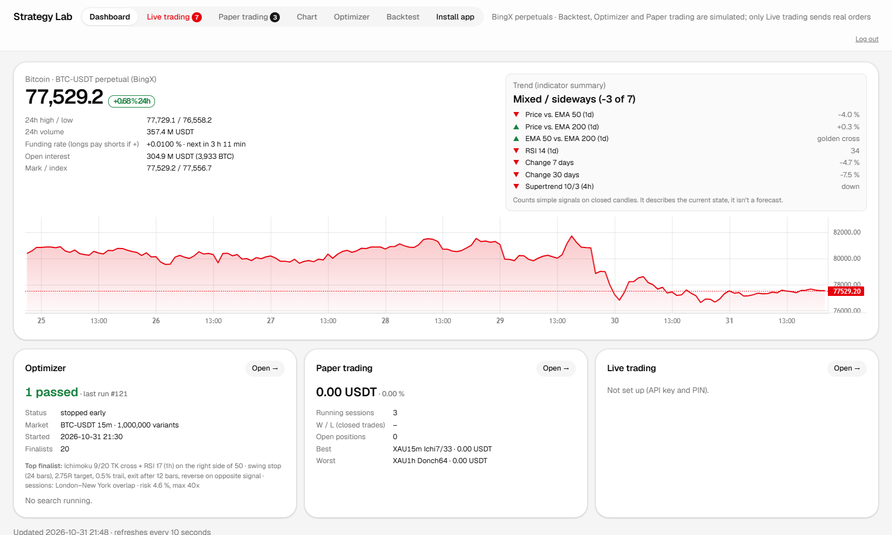
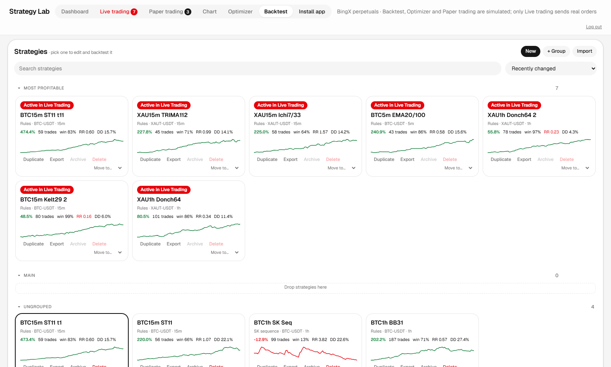
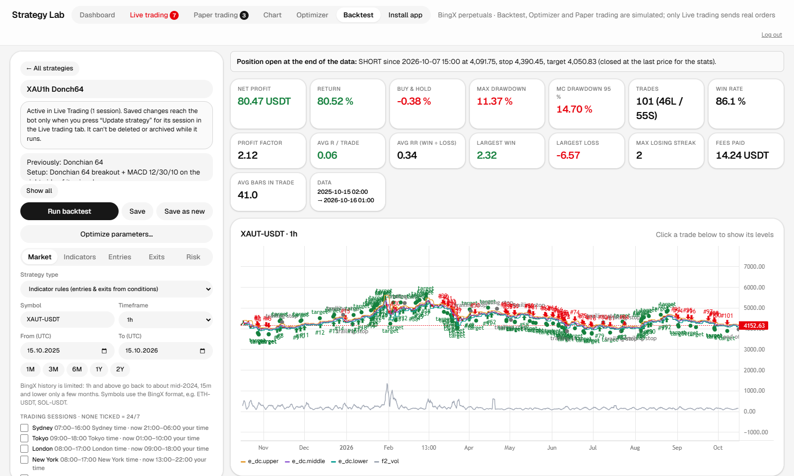
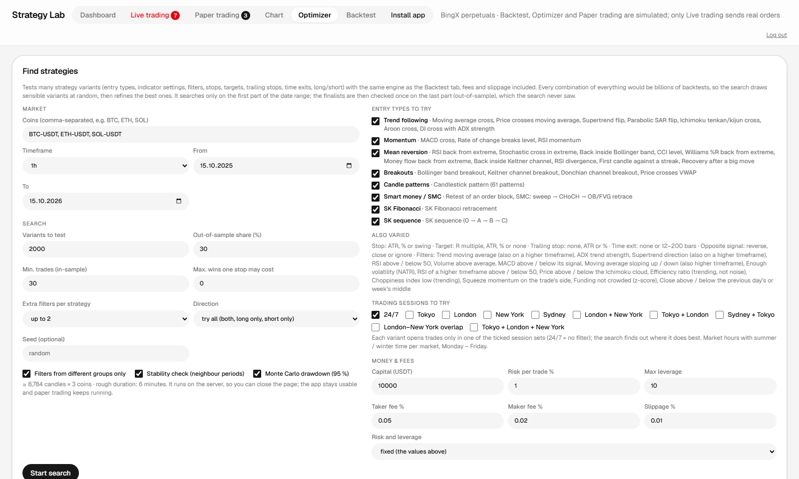
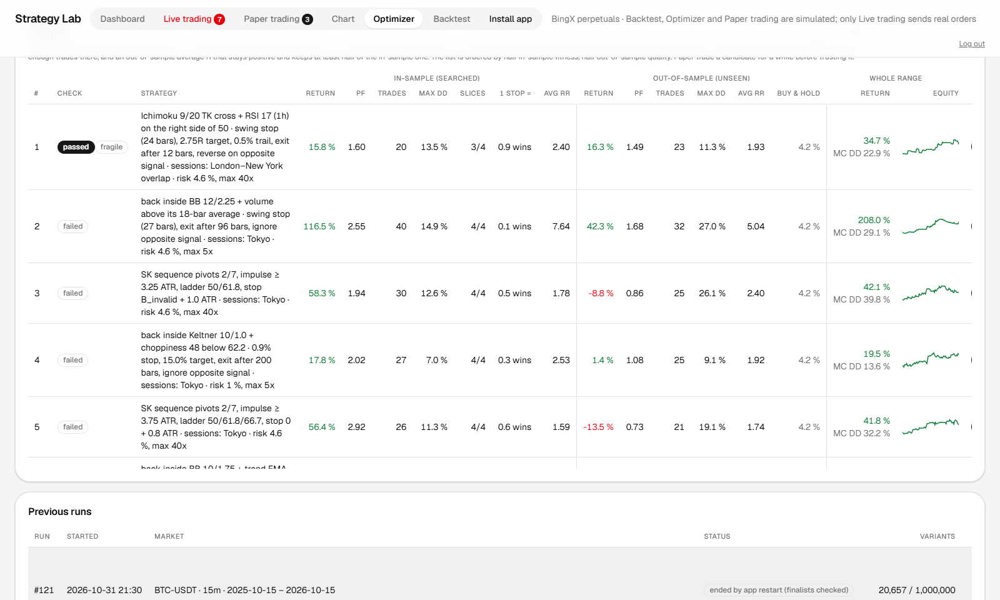
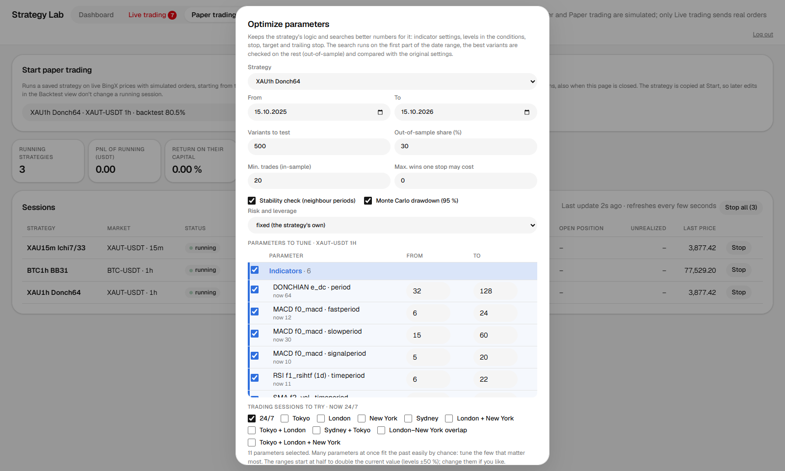
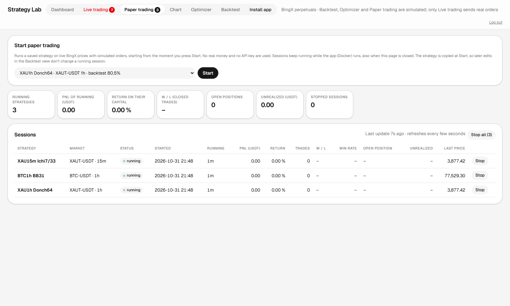

# Strategy Lab

A personal web app for building, backtesting, paper trading and live trading crypto strategies on
BingX perpetual futures. It runs locally in Docker (FastAPI and plain JavaScript).

**Read the handbook:** <https://christsoler.github.io/StrategyLab/>
(or open [`index.html`](index.html)). It explains how every part works: strategies and indicators, the
rules engine, the SK and Smart money systems, the simulation rules, the Optimizer and its out-of-sample check,
paper trading, and the safety rules of the live trading bot.

> The source code is not published (yet). This repository holds only the handbook and screenshots.

## Screenshots

**Dashboard**: BTC market data, a trend summary and the status of the other tabs.

**Backtest overview**: every saved strategy as a tile.

**One strategy**: editor, result figures and the price chart with every trade.

**Optimizer**: search settings and switches.

**Optimizer results**: in-sample against out-of-sample, the pass check and the "fragile" tag.

**Optimize parameters** of one saved strategy.

**Paper trading**: strategies running forward on live prices with simulated orders.

Screenshots come from a test copy of the app (no login, no exchange key). The figures are backtest and
simulation results, not real account data, and past results say nothing certain about future ones.
