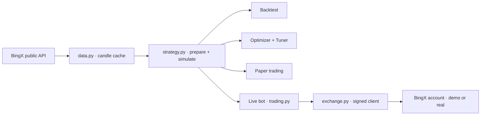
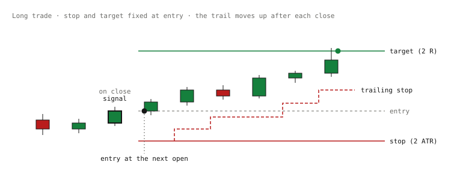
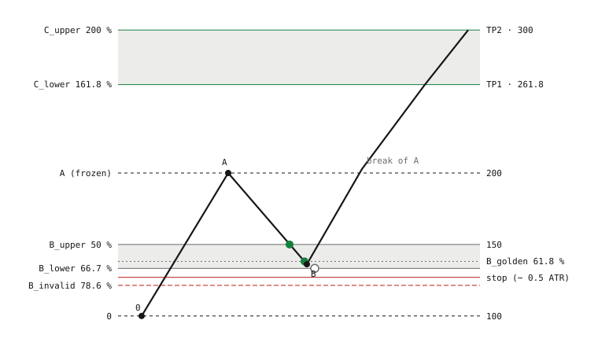
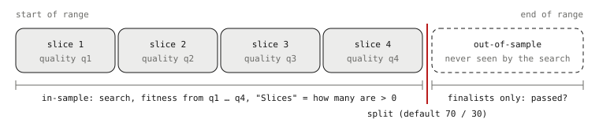

# Strategy Lab Handbook

A personal web app for building, backtesting, paper trading and live trading crypto strategies on BingX perpetual
futures. It runs locally in Docker (FastAPI and plain JavaScript). This handbook explains how every part works.

> The source code is not published (yet). This repository holds the handbook and screenshots of the app.
> Screenshots come from a test copy of the app; their figures are backtest and simulation results, not real account data.


## Contents
- **Basics**: [Overview](#overview) · [How it is built](#how-it-is-built) · [Market data](#market-data)
- **Strategies**: [A strategy](#a-strategy) · [Indicators](#indicators) · [Conditions](#conditions) · [Rules engine](#rules-engine) · [SK Fibonacci](#sk-fibonacci-type-sk) · [Smart money](#smart-money-type-smc) · [SK sequence](#sk-sequence-type-sks) · [Simulation rules](#simulation-rules) · [Result figures](#result-figures)
- **Tabs**: [Backtest](#backtest-tab) · [Optimizer](#optimizer) · [Optimize parameters](#optimize-parameters) · [Paper trading](#paper-trading) · [Live trading](#live-trading) · [Dashboard & Chart](#dashboard--chart)
- **Running it**: [Access & security](#access--security) · [Operations](#operations) · [Review checklist](#review-checklist)

## Overview

One person uses it, from a desktop browser or a phone (it installs as an app). It runs on a home PC in Docker and is reachable from outside through a Cloudflare tunnel behind the app's own login.

**Dashboard:** Start page: BTC market snapshot and the status of the optimizer, paper and live trading.

**Backtest:** All saved strategies as tiles. Open one to edit it and see its backtest: chart, trades, figures.

**Optimizer:** Searches thousands of strategy variants and checks the best on data the search never saw.

**Paper trading:** Runs saved strategies forward on live prices, with simulated money.

**Live trading:** A bot that makes the BingX account follow a strategy. Demo account by default.

**Chart:** An embedded TradingView chart for looking at the market.

**Only the Live trading tab sends real orders**, with the owner's own API key. Backtest, Optimizer and Paper trading only read public market data.

The same simulation engine drives Backtest, Optimizer, Paper trading and the Live bot's decisions, so a strategy behaves the same in each.

## How it is built

- **Backend**: Python 3.13, FastAPI, NumPy/pandas, TA-Lib for indicators.
- **Frontend**: plain JavaScript, no framework. Charts with lightweight-charts. One URL hash per tab.
- **Storage**: one SQLite file in a Docker volume: candle cache, strategies, groups, paper and live sessions, optimizer runs, live events and settings.
- **Background threads**: paper trading (every 10 s), live trading bot (every 10 s), one optimizer run at a time.



### Main files

| File | Role |
| --- | --- |
| `data.py` | Candles and funding history from BingX, cached in SQLite. |
| `indicators.py` | Indicator catalog: TA-Lib plus custom ones. |
| `rules.py` | Turns conditions into true/false per candle. |
| `rule_engine.py` | Executes rule strategies: entries, stops, targets, trailing, sizing. |
| `engine.py` | SK Fibonacci strategy. |
| `smc.py` | Smart money analysis (structure, order blocks, gaps, liquidity). |
| `sk_sequence.py` | SK sequence system: state machine, execution, paper exchange. |
| `strategy.py` | Validates a strategy and runs the right engine. |
| `sessions.py` | Trading-session filter (Sydney, Tokyo, London, New York). |
| `stats.py` | Result figures shared by all strategy types. |
| `optimizer.py`, `tuner.py` | Strategy search and parameter tuning. |
| `live.py` | Paper trading. |
| `trading.py`, `exchange.py` | Live bot and the only module that sends orders. |
| `trade_chart.py` | Chart of live trades with their stop and target path. |
| `auth.py`, `store.py`, `naming.py` | Login, database, strategy names. |

## Market data

- Candles come from BingX's public perpetual-futures API, at most 1000 per request, and are cached in SQLite so each range is downloaded once.
- History: about mid-2024 onwards for 1h and longer timeframes, about 3 months for 1m–15m.
- The forming (unfinished) candle is only used where it is marked as such: paper and live trading show it, but never decide on it.
- Funding rates are loaded for the FUNDING indicator and the dashboard. They are not charged in the simulation.
- All data and backtest date ranges are in UTC. The UI shows times in the browser's local time.

## A strategy

A strategy is one JSON document, saved in the database and exportable as a file. Its parts:

| Part | Content |
| --- | --- |
| Market | Coin (e.g. BTC-USDT), timeframe, date range for the backtest. |
| Type (mode) | `rules`, `sk` (SK Fibonacci), `smc` (Smart money) or `sks` (SK sequence). |
| Indicators | Any number, each with its parameters and optionally a higher timeframe. |
| Long / short entry | A list of conditions per side; each side can be switched off. For SK, SMC and SK sequence they act as filters. |
| Exit conditions | Optional conditions that close a long or short (rules type). |
| Exits | Stop, target, trailing stop, time exit, opposite-signal handling (rules and SMC). |
| Risk | Starting capital, risk per trade, position size without a stop, max. leverage, maker fee, taker fee, slippage. |
| Sessions | Optional trading hours; empty = around the clock. |
| Type sections | `sk`, `smc`, `sks`: the settings of each special type. |

### Names

Names have at most 15 characters: coin, timeframe, entry indicator and period, e.g. `BTC15m ST11` (Supertrend 11) or `XAU1h Donch64`. " L" / " S" mark one side only, " 2" a duplicate name. The long description of an optimizer result goes into the notes as "Setup: …".

### Organising

Strategies can be put into user groups (drag and drop or "Move to…"), archived, duplicated, exported and imported. A strategy that runs in live trading is marked "Active in Live Trading" and cannot be deleted or archived.

## Indicators

- All TA-Lib functions, including 61 candlestick patterns.
- Custom: Supertrend, Ichimoku, Keltner, Donchian, VWAP, SWING (confirmed swing points), FIB (Fibonacci levels), DIVERGENCE, ORDERBLOCK, STREAK (candles in a row), CHANGE (move over N candles), FUNDING.
- **Higher timeframe**: any indicator can run on a higher timeframe (e.g. RSI 14 on 1d inside a 1h strategy). Its value only appears after that higher candle has closed, so no future data leaks in.
- ORDERBLOCK: the last opposite candle before a close beyond the last confirmed swing. The zone ends when price closes through it, or once price has left it after **touches** visits (default 1: a block is used once; 0 = unlimited, the old behaviour). Its in-zone outputs (0/1) are drawn below the chart.

### Regime, volatility and liquidity indicators

Added on 2026-10-31. They are ordinary indicators: a strategy only uses them if you add them. The Optimizer also draws them as filters.

| Indicator | Settings | Output |
| --- | --- | --- |
| KER (Kaufman efficiency ratio) | period 14 | Net move over N candles ÷ the sum of all candle-to-candle moves: 0 = pure chop, 1 = a straight trend. Named KER because TA-Lib already has an “ER”. |
| CHOP (choppiness index) | period 14 | 0–100 from the summed true range against the N-candle range. Above 61.8 = sideways, below 38.2 = strong trend. |
| SQUEEZE (Bollinger inside Keltner) | length 20, BB 2.0, KC 1.5 | `sqz_on` 1 while the Bollinger Bands lie inside the Keltner Channels; `sqz_fired` 1 on the candle the squeeze ends; `momentum` = linear regression of close minus the average of the Donchian middle and the SMA. |
| PDHL (previous day / week, UTC) | weekly 0 / 1 | High, low and middle of the last finished UTC day (or week from Monday 00:00), only after it has closed; `swept_high` / `swept_low` = 1 when a candle wicks beyond it and closes back inside. |
| FUNDING\_Z (funding z-score) | period 60 | (funding − its N-candle average) ÷ its spread; 0 while the rate doesn't change. +2 = longs crowded. Base timeframe only. |

## Conditions

A condition compares two things on the candle's close: a price field, an indicator output or a number.

| Operator | Meaning |
| --- | --- |
| > < ≥ ≤ | Above, below, at or above, at or below. |
| crosses above / below | Was on the other side on the previous candle, is on this side now. |
| rising / falling | Higher / lower than on the previous candle. |

Options per condition: **bars ago** (compare an earlier candle's value) and **within last N** (true if it was true on any of the last N candles). All conditions of one side must be true at the same time.

## Rules engine

For the type "rules" (and the execution of Smart money signals).

### Entry

The conditions are checked on each candle's close. A signal enters at market on the **next candle's open**. Sessions and the strategy's filters only block new entries, never exits.

  
*R = entry − stop. The target sits at 2 R above the entry. If a candle touches both stop and target, the stop counts.*

### Exits

| Exit | Choices | Default |
| --- | --- | --- |
| Stop | none · percent · ATR multiple · swing (extreme of the last N candles) | 2 × ATR(14) |
| Target | none · percent · ATR multiple · R multiple (of the stop distance) | 2 R |
| Trailing stop | none · percent · ATR multiple; moves only after a candle closes, never loosens | none |
| Time exit | close after N candles (0 = off). Switch: **only below R** (0 = off). If set, e.g. to 0.5, a trade that is at least 0.5 R in profit at that close stays open and is left to its stop, trail and target. Only trades that are stuck get closed. | off |
| Opposite signal | reverse · close · ignore | reverse |
| Exit conditions | own condition lists for leaving a long or a short | none |

### Position size

- With a stop: the size is chosen so a stop-out costs **risk per trade** (default 1 %) of the current equity, fees and slippage included.
- Without a stop: **size %** of equity (default 100 %).
- Leverage is capped by **max. leverage** (default 10) and by the liquidation rule below.

### Liquidation rule

With isolated margin a position is liquidated after a move of roughly 1 / leverage. The engine uses the highest leverage for which *stop distance + 2.5 % buffer < 1 / leverage* (`safe_leverage`), and caps the size to it. The buffer covers BingX's maintenance margin (about 0.5–2 %), the liquidation fee and slippage. It was 1 % before 2026-10-31. Example: a 1 % stop allows at most 28×, a 5 % stop 13×. So the stop always comes before liquidation, in the backtest and on BingX, where the live bot sets exactly that leverage.

## SK Fibonacci (type “sk”)

The older, simpler Fibonacci strategy. A swing from 0 to A, a limit entry at a retracement of it, Fibonacci extensions as targets.

| Setting | Default | Meaning |
| --- | --- | --- |
| Pivot bars | 8 | Candles each side that confirm a swing point. |
| Min. impulse | 0.8 % | Minimum size of 0 → A. |
| Entry level | 50 % | Limit order at this retracement of 0 → A. |
| Stop level | 100 % + 0.05 % | At point 0 plus a buffer. |
| TP1 / TP2 | 161.8 % / 200 % | Extensions; TP1 closes 50 %, then the stop goes to break-even. |
| Min. reward:risk | 1.0 | Setups with less are skipped. |
| Max. wait | 48 candles | Unfilled entry is cancelled after this. |
| Trend EMA | off | Optionally trade only in an EMA's direction. |

Works in Backtest, Optimizer and Paper trading. Live trading refuses it.

## Smart money (type “smc”)

Finds the setup **liquidity sweep → change of character (CHoCH) → retrace into an order block or fair value gap**, and enters at market on the next open with a stop and target set by the setup.

- **Structure**: swing points (5 bars each side), break of structure (BOS) and CHoCH, by candle close or wick.
- **Order blocks**: the last opposite candle before the break (searched 10 candles back), optional volume filter. Gone after the first tap (mitigated) or when a candle closes through it.
- **Fair value gaps**: three-candle gaps, optional minimum size in ATR. Also used once: gone after the first tap or a close through it.
- **One entry per zone**: a zone that gave an entry is flagged *used* and can never give a second one.
- **Liquidity**: equal highs/lows (within 0.1 ATR) or every swing; a sweep must close back inside the level.
- **Zones**: longs only from discount, shorts only from premium (switchable); optional OTE band 61.8–78.6 %.
- **Timing**: CHoCH within 30 candles of the sweep, entry within 30 candles of the CHoCH.
- **Risk**: stop 0.1 ATR beyond the order block (or the sweep); target the nearest liquidity pool or opposing order block with at least 2 R, optional fallback R; trades below the min. R are skipped.
- **Sessions**: Asia, London, New York, overlap.

The strategy's conditions act as filters; trailing stop, time exit and opposite-signal handling from the exits still apply. Works in all tabs including Live trading.

## SK sequence (type “sks”)

A full 0 → A → B → C state machine with a ladder of limit orders. It runs on a simulated exchange with a ccxt-style order interface, so order handling can be checked step by step. Works in Backtest, Optimizer and Paper trading. Live trading refuses it.

### Levels (long; short is the mirror image)

  
*Example: 0 = 100, A = 200, so R = 100; B = 136. Filled dots: ladder orders at 50 % and 61.8 % filled. Hollow dot: the 66.7 % order did not fill. Shaded bands: B zone and C zone.*

```
R = A − 0
B zone:   B_upper 50 %  ·  B_golden 61.8 %  ·  B_lower 66.7 %   (retracements of A)
B_invalid = 78.6 % retracement
C targets: C_lower = 0 + 1.618 R (TP1)  ·  C_upper = 0 + 2.0 R (TP2)
```

### Life cycle

1. **Impulse**: the last two confirmed swing points form 0 → A if the move is at least *x* × ATR. Skipped if price already went beyond A or into B while A was being confirmed.
2. **Before the dip**: new extremes move A (trail). If a confirmed swing formed above 50 % and price then makes a new extreme, and that new leg is big enough, point 0 moves to that swing (*re-anchor*). A newer valid impulse replaces a sequence that is still waiting with nothing filled (*supersede*). A candle that both extends A and dips counts as a trail, unless a ladder order filled on it.
3. **B zone**: the first dip to 50 % freezes A; B is the extreme of the dip.
4. **Entry**: a limit ladder (50/61.8/66.7 %, equal or weighted sizes) placed right after the impulse, or a confirmation candle in B that buys at the next open.
5. **Invalidation**: beyond 78.6 % (or point 0) by close or wick. Before any fill it ends the setup. After a fill only the hard stop closes the trade by default; unfilled entries are cancelled. Optionally the invalidation also closes the trade at the next open.
6. **Break of A**: B confirmed, unfilled entries cancelled, stop to break-even (entry + fees), C targets active. Break-even can also come earlier at a set R.
7. **Exits**: TP1 at 161.8 % closes a share and moves the stop of the rest to A; TP2 at 200 % closes the rest. Target sizes always follow the filled size.

### Settings

| Setting | Default | Meaning |
| --- | --- | --- |
| Pivot bars left / right | 5 / 5 | Swing confirmation; known only after the right bars. |
| Min. impulse | 3 × ATR(14) | Minimum size of 0 → A (also for a re-anchored leg). |
| Max. wait for B | 100 candles | No dip to 50 % in time: dropped (0 = off). |
| Runaway | 1 × R | One candle extending A by more than this drops the sequence. |
| Invalid beyond / by | 78.6 % / close | Or point 0 (− buffer); or wick. |
| Once an entry filled | only the stop | Or "invalidation closes it too" (the earlier behaviour). |
| Entry / ladder | ladder 50/61.8/66.7 | Or 50/61.8, 61.8/66.7, or a confirmation candle. |
| Ladder sizes | equal | Or weighted 20/30/50 (40/60 for two levels); total risk unchanged. |
| Stop below / buffer | B\_lower / 0.5 ATR | Anchor B\_lower 66.7 %, B\_invalid 78.6 % or point 0. |
| Break-even also at R | 1.5 | 0 = only at the break of A. |
| TP1 share | 0.5 | Part closed at 161.8 %. |

Size: a stop-out with every ladder level filled costs the risk %, maker fee in, taker fee and slippage out included. `python -m app.sk_demo` prints a full synthetic life cycle.

## Simulation rules

These hold for every strategy type and every tab.

- **No look-ahead**: signals on closed candles only; swing points count only once confirmed; higher-timeframe values only after that candle closes. A test checks that cutting the data off earlier gives the same earlier decisions.
- **Order of fills inside a candle**: if a stop and a target are both inside one candle, the stop counts first.
- **Fees**: market orders and stops pay the taker fee plus slippage; limit orders and targets pay the maker fee. Defaults: maker 0.02 %, taker 0.05 %, slippage 0.01 %.
- **Gaps**: an order whose price was jumped over fills at the candle's open.
- **Not simulated**: funding payments, order-book depth, partial fills of market orders.
- **Same engine**: Backtest, Optimizer, Paper trading and the live bot's decisions call the same `strategy.simulate`.

## Result figures

| Figure | How it is calculated |
| --- | --- |
| Net profit / Return | Sum of trade results after fees; return on the starting capital. |
| Buy & hold | Price change of the coin over the same range, for comparison. |
| Max drawdown | Largest fall of equity from a previous peak, per candle, in %. |
| MC drawdown 95 % | The historical drawdown depends on the exact order of the trades. The same trades are reshuffled 1000 times (each kept as a % of the equity before it); the figure is the drawdown 95 % of those orders stay within. Usually deeper than the historical one. Needs 10 trades. Switch: Risk tab “Show Monte Carlo drawdown” (Backtest) and the Optimizer / tune form (shown under “Whole range”). |
| Win rate | Trades with a profit ÷ all trades. |
| Profit factor | Sum of wins ÷ sum of losses. |
| Avg R / trade | Average of each trade's result ÷ its risk at entry. |
| Avg RR (win ÷ loss) | Average win ÷ average loss. 0.1 = you win 1 and lose 10. Red below 0.33. |
| 1 stop = | How many average wins one full stop-out costs, from the wins' R multiples (known even before the first loss). Optimizer only. |
| Largest win / loss, max losing streak, fees, avg bars in trade | As named. |
| Quality (SQN) | Average trade ÷ spread of trades × √trades (capped at 100). Used by the optimizer. |

## Backtest tab

- **Overview**: every saved strategy as a tile with return, trades, win rate, Avg RR, drawdown and a small equity curve. Search, sort, groups, archive.
- **Detail**: the editor (Market, Indicators, Entries, Exits / type section, Risk, Sessions) and the result: figures, price chart with trade markers, equity curve, trade list. Clicking a trade shows its stop and target levels.
- Save, Save as new, Duplicate, Export, Import, and "Optimize parameters…".
- On a phone the editor and the result are shown one at a time.

  
*Backtest overview: every saved strategy as a tile, in groups.*

  
*One strategy: the editor on the left; result figures (including the Monte Carlo drawdown) and the price chart with every trade on the right.*

## Optimizer

Searches for strategies on one timeframe and one or more coins (default BTC, ETH and SOL). Each coin gets its own full search and its own result list. One run at a time, in the background.

  
*The Optimizer form: what to search, and the switches for filter groups, stability check and Monte Carlo drawdown.*

### 1 · The data split

The date range is cut in two: the first part (default 70 %) is **in-sample**, where the search happens; the rest is **out-of-sample**, which the search never sees.

  
*The search only ever sees the in-sample part. The 20 finalists are then run once on the out-of-sample part; that run decides "passed" and the order of the list.*

### 2 · Variants

A variant = one entry family + up to N filters (default 2) + an exit set + trading sessions.

**Entry families:** Trend (MA cross, price vs MA, Supertrend, SAR, Ichimoku, Aroon, DI/ADX), momentum (MACD, ROC, RSI), reversion (RSI, Stochastic, Bollinger, CCI, Williams %R, MFI, Keltner, divergence, streak, big move), breakout (Bollinger, Keltner, Donchian, VWAP), SMC (order block, full setup), candle patterns, SK Fibonacci, SK sequence.

**Filters:** Trend MA (also higher timeframe), ADX, Supertrend, RSI side, volume, MACD side, MA slope, volatility (NATR), higher-timeframe RSI, Ichimoku cloud, efficiency ratio (KER), choppiness, squeeze momentum, funding z-score (no longs while longs are crowded, mirror for shorts), previous day / week middle.

**Exits:** Stop: ATR, percent or swing. Target: R, ATR, percent or none. Trailing: none, ATR or percent. Time exit. Opposite signal. SK, SMC and SK sequence bring their own exits.

The search first draws random variants (broad phase), then mutates the best ones (refine phase). Indicator results are cached. The budget is the number of variants tried per coin (default 2000).

**Filters from different groups only** (switch, default on): filters are sorted into four groups, and a variant takes at most one from each, both when it is drawn and when it is mutated. Two filters that measure the same thing add nothing but a closer fit to the past. With the switch off, any filters may be combined (the old behaviour; then up to 5 filters, otherwise at most 4).

| Group | Filters |
| --- | --- |
| Trend direction | Trend MA, Supertrend, Ichimoku cloud, MA slope |
| Regime / volatility | ADX, NATR, KER, choppiness, squeeze |
| Momentum | RSI side, higher-timeframe RSI, MACD side |
| Volume / sentiment / structure | Volume, funding z-score, previous day / week |

### 3 · Fitness (what the search ranks by)

```
in-sample cut into 4 time slices
quality per slice = average trade ÷ spread of all trades × √(trades in slice)
fitness = √4 × (mean of slices − ½ × spread of slices) − 0.15 × number of filters
```

So an edge that only shows in one period counts little, and every extra filter has to earn its place. Variants with fewer than the minimum trades (default 30) are ignored. An optional limit drops variants whose stop-out costs more than N average wins.

### 4 · Finalists and the out-of-sample check

The best 20 (at most 3 per entry family) run on the out-of-sample part. Trying 20 finalists on one period means one of them can pass by luck, so the bar is set high (since 2026-10-31). **Passed** means all of:

- profit in-sample and profit out-of-sample;
- out-of-sample profit factor ≥ **1.25** (was 1.1);
- out-of-sample **average R** above 0 and at least **half** the in-sample one, so the expectancy didn't collapse while one lucky trade kept the profit (skipped for strategies without a stop);
- at least max(5, min. trades ÷ 3) out-of-sample trades.

### 5 · Stability check

Switch, default on (Optimizer form and tune dialog). Each finalist is run again on the in-sample part with its main entry period about 10 % lower and higher (at least one step); the tuner uses the first indicator period. If a neighbour loses money, or keeps less than half the fitness, the finalist is a lone spike and is marked **fragile** (hover the tag to see what the neighbours did). A plateau of values that all work is more likely to hold up.

### 6 · Order of the result list

```
1. passed before failed
2. robust before fragile
3. score = ½ × in-sample fitness + ½ × out-of-sample quality (SQN)
```

So a strategy with a lucky out-of-sample spike but an unsteady search period no longer jumps to the top. The tuner orders its variants the same way (after the original row). Return, Avg RR and drawdown are shown but do not change the order.

  
*Optimizer results: in-sample against out-of-sample per finalist, the pass check and the “fragile” tag.*

### Risk and leverage

The fitness does not depend on position size, so size is not searched. Optionally a range of risk % and leverage is tried per finalist on the in-sample part; the highest return whose max drawdown stays under a limit is kept.

Many variants are tried, so some will fit the past by chance. A passed result is a candidate for paper trading, not proof of an edge.

## Optimize parameters

From a saved strategy in the Backtest tab. It keeps the logic and tunes the numbers inside chosen ranges: indicator parameters, number levels in conditions, exit values, SK / SMC / SK sequence settings, sessions. It runs as an optimizer job with the same split, fitness and pass check. The result list starts with the original settings for comparison; tuned variants are named `<name> t1`, `t2`, …

  
*Optimize parameters: tunes the numbers of one saved strategy inside chosen ranges.*

## Paper trading

- Start a session from a saved strategy. Every 10 s a background thread re-runs the strategy from the session's start time to now, the forming candle included but never decided on.
- Shows equity, realized and unrealized PnL, closed trades, the open position and its levels.
- After downtime it catches up by itself, because it always replays from the start.
- The replay only runs when it can change something: a candle has closed, the strategy changed, or the forming candle made a new high or low while a position or pending order is open (stops, targets and limits fill on it). Otherwise the last result is reused and only the open position is valued at the latest price, which gives the same figures with far less work. Live trading uses the same cache.
- Each session runs its own copy of the strategy; editing the saved strategy doesn't change a running session.

  
*Paper trading: strategies running forward on live prices with simulated orders.*

## Live trading

**BingX demo account (VST) by default** · **real money only after PIN + typing REAL MONEY**

### How the bot works

- Every 10 s it replays each session's strategy (like paper trading) and makes the BingX position follow the simulated one: market entry with stop and target attached, trailing stop moved, exit closes.
- Rule and Smart money strategies with a stop only; SK Fibonacci and SK sequence are refused.
- It never reopens after an exchange stop, skips signals that are already late, and only manages positions it opened itself (tracked by position ID and its own stop/target order IDs).
- It sets the leverage from the liquidation rule, so the stop comes before liquidation.
- Stops never get looser at BingX.
- **Moving a stop never leaves the position without one**:
  1. The new stop is placed first. Only when BingX confirms it is the old one cancelled.
  2. BingX normally allows one stop per position and refuses the second. The bot then cancel-replaces it, up to 3 times with short pauses, checking the open orders each time. If only the cancel went through, it places the new stop straight away.
  3. If that still fails: the old stop stays if it is still there. If it is gone, it is placed again at its old price. If BingX says a stop already exists for that position side, or shows one that can close it, the position is kept and the bot tries again on the next round. Only if there is really no stop at all is the position **closed at market**, with a CRITICAL event; the session never reopens it.
- **Several positions on one coin and side** (separate isolated margin): BingX's cancel-replace attaches the new stop to the *first* position of that side, whatever position it was meant for. So for these the bot cancels the old stop and places the new one tied to its own position (one request apart), and it matches stops to positions by BingX's position ID. Found on 2026-10-30, when one XAUT short ran without a stop of its own for about a day.
- Closed trades are read back from BingX's position history, net of fees and funding.

### Safety

- **Trading PIN** for every action: start, stop, risk change, strategy update, resume, kill switch, switching account.
- **Daily loss limit** (default 5 %): if account equity falls that far below the day's start (UTC), all sessions halt and close. Kept per account, so a demo hit never blocks real money. Reset once per day with PIN.
- **Kill switch**: cancels every order and closes every position on the account.
- Halted sessions don't restart by themselves; "Resume" sets them running again.

### Changing a running session

- **Risk**: new risk % and leverage for the next entries; the open position is unchanged.
- **Update strategy**: takes the newest saved version (same coin). With an open position it waits until the session is flat.
- One running session per strategy. Several sessions on one coin need isolated-per-position margin on BingX.

### Chart section

A candle chart per coin with every session's trades: entry, exit, and the stop/target path the bot set at BingX (read from the activity log, drawn as step lines). Hovering or clicking a trade highlights its lines.

## Dashboard & Chart

- **Dashboard**: BTC price, 24 h figures, funding rate, open interest, a 7-day chart, a trend summary from simple signals, and the status of optimizer, paper and live trading.
- **Chart**: an embedded TradingView widget.

  
*Dashboard: BTC market data, a trend summary from simple signals, and the status of the other tabs.*

## Access & security

- **Login**: user name and a PBKDF2 password hash in `.env`; 30-day signed session cookie; lockout after failed logins. Without a configured login every request is refused.
- **Remote access**: Cloudflare Tunnel to a subdomain, protected only by the app's login. The app port is bound to 127.0.0.1.
- **API key**: the BingX key and secret live only in `.env`, entered by the owner through a script. Requests are signed with HMAC; `exchange.py` is the only module that sends orders.
- Public paths without login: the web-app manifest, service worker (caches nothing) and icons.

## Operations

| Task | How |
| --- | --- |
| Run / stop | `docker compose up -d --build` / `docker compose down` (never `down -v`: it deletes the data volume) |
| Tests | pytest in the app's Docker image with a throwaway database (145 tests) |
| Backup / restore | `scripts\backup-data.ps1`, `scripts\restore-data.ps1` |
| Login / trading key | `scripts\set-login.ps1`, `scripts\set-trading.ps1` |
| Move to another PC | export, restore and tunnel scripts; the old PC must be stopped first so orders are never doubled |

Before a rebuild, a running optimizer search is checked: a restart ends it (the finalists found so far are still checked and saved).

## Review checklist

Points worth checking first, because they decide whether results can be trusted.

- **Look-ahead:** Signals on closed candles, confirmed swings, higher-timeframe values after close. Compare a backtest on a cut-off range with the full one.
- **Intrabar order:** Only OHLC is known. Stop before target is the conservative choice; entry-then-target within one candle (SK sequence ladder) is the optimistic exception.
- **Costs:** Fees and slippage are included; funding is not. On long holds with high funding this flatters results.
- **Overfitting:** The optimizer tries thousands of variants. The stricter pass check, the stability check (“fragile”) and the Monte Carlo drawdown help; still check the out-of-sample trade count, the slices, and paper-trade before going live.
- **Stop protection:** Moving a live stop places the new one first, retries, and closes the position at market if no stop can be kept. Watch the activity log for CRITICAL events.
- **Live vs simulation:** The bot follows the simulation; differences come from fills, late signals (skipped), manual interference and exchange stops.
- **SK sequence geometry:** C targets measured from point 0, B zone from the first touch of 50 %, wick vs close for invalidation and the break of A, re-anchoring and superseding.
- **Liquidation:** Size capped so stop distance + 2.5 % < 1 / leverage; BingX raises the maintenance margin for very large positions, so check those.
